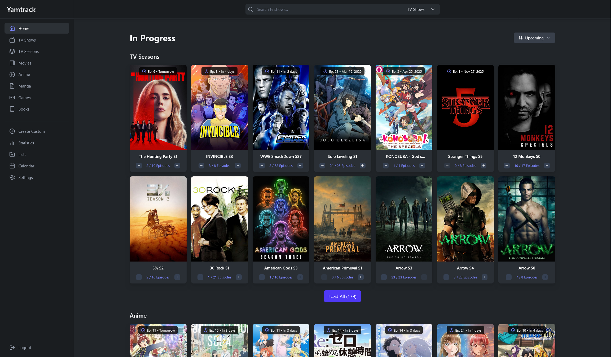

# Yamtrack

Yamtrack is a self-hosted media tracker for movies, TV shows, anime, manga, video games, books, comics, and board games — your own private Trakt-style library with ratings, progress, a calendar of upcoming releases, and imports from Trakt, Simkl, AniList, and IMDb. One click deploys the official image (ghcr.io/fuzzygrim/yamtrack v0.26.3, AGPL-3.0) with a Redis companion: the admin account is seeded on first boot, search works out of the box with upstream's shared metadata keys, and your library survives redeploys on a Railway volume.

Screenshot: upstream's own homepage screenshot (FuzzyGrim/Yamtrack README), showing the media library with posters, ratings, and progress.

## Source Repository

[https://github.com/INAPP-Mobile/yamtrack](https://github.com/INAPP-Mobile/yamtrack)

## Deploy and Host

One click deploys Yamtrack 0.26.3 (official `ghcr.io/fuzzygrim/yamtrack` image, pinned by digest) plus a Redis 8 companion service. The deploy form has two generated fields — a Django secret key and an admin password — and one auto-wired Redis host, nothing else to fill in. On first boot the admin account (`admin` + your generated password) is created automatically, open registration is closed, and the site is ready: log in, search for a movie or show, and add it to your library.

## Why Deploy

- **Zero-fuss start:** no setup wizard to click through, no email step — the admin account is seeded on first boot and registration is closed so the instance is not world-open.
- **Real media tracking:** movies, TV, anime, manga, games, books, comics, and board games in one library, with ratings, progress, lists, a release calendar, and imports from Trakt, Simkl, AniList, and IMDb.
- **Search works out of the box:** TMDB, MyAnimeList, IGDB, Hardcover, and ComicVine ship shared default API keys upstream — bring your own keys only if you hit their rate limits.
- **Private by default:** your watch history and library stay in your own SQLite database on your own volume; no third-party tracker sees it.

## Common Use Cases

- Replace Trakt/Letterboxd/Goodreads with a single self-hosted library you own outright.
- Track what you watch, read, and play across media types, with progress and a calendar of upcoming releases.
- Import an existing Trakt, Simkl, AniList, or IMDb history and keep tracking from there.
- Run a private household tracker — one admin account, extra users managed from Django's `/admin/`.

## Configuration

| Variable | Default | What it does |
|---|---|---|
| `SECRET` | `${{secret(50)}}` (generated) | Django secret key for cryptographic signing. Upstream's default is a publicly known value — never deploy with it. |
| `YAMTRACK_ADMIN_PASSWORD` | `${{secret(16)}}` (generated) | Password for the auto-seeded admin account (username `admin`, email `admin@yamtrack.local`). |
| `REDIS_HOST` | `${{redis.RAILWAY_PRIVATE_DOMAIN}}` | Redis host, auto-wired from the companion service over the private network. |
| `REGISTRATION` | `False` (baked) | Open signup is closed; the seeded admin is the account. Set `True` to let anyone register. |
| `ADMIN_ENABLED` | `True` (baked) | Django's `/admin/` interface is enabled for user management. |
| `TZ` | `UTC` (baked) | Container timezone. |
| `URLS` | derived at boot from `RAILWAY_PUBLIC_DOMAIN` | CSRF trusted origins + allowed hosts (upstream's shortcut for both settings). Set explicitly only if you serve it behind a custom domain. |
| `YAMTRACK_INTERNAL_PORT` | mapped from `PORT` on every boot | Port nginx listens on inside the container. Never set to `23847` — reserved for gunicorn. |
| `YAMTRACK_ADMIN_USERNAME` | `admin` | Username of the seeded admin account. |
| `TMDB_API` | shared default ships upstream | TMDB key for movies and TV. Bring your own for heavy use. |
| `TMDB_LANG` | `en-US` (upstream default) | Metadata language (ISO 639-1, optionally + country code). |
| `TMDB_NSFW` | `False` (upstream default) | Include adult content in TMDB searches. |
| `MAL_API` | shared default ships upstream | MyAnimeList key for anime and manga. |
| `IGDB_ID` / `IGDB_SECRET` | shared defaults ship upstream | IGDB keys for games; low rate limit — bring your own for heavy use. |
| `HARDCOVER_API` | shared default ships upstream | Hardcover key for books. Custom values must include the `Bearer ` prefix. |
| `COMICVINE_API` | shared default ships upstream | ComicVine key for comics. |
| `PUID` / `PGID` | `1000` (upstream defaults) | User/group the app files are owned by in-container. |
| `WEB_CONCURRENCY` | `1` (upstream default) | Number of web server processes. |
| `TRACK_TIME` | `True` (upstream default) | Set `False` to disable time tracking. |
| `DEBUG` | `False` (upstream default) | Set `True` for debugging only. |
| `REDIS_PREFIX` | — (optional) | Prefix for Redis keys when sharing one Redis instance. |
| `CELERY_REDIS_URL` | defaults to `REDIS_URL` | Celery broker URL if different from the cache URL. |
| `HEALTHCHECK_CELERY_PING_TIMEOUT` | `1` (upstream default) | Timeout for the `/health/` celery ping. |
| `DB_HOST` | — (optional) | Set to use PostgreSQL instead of the default SQLite (then also `DB_NAME`, `DB_USER`, `DB_PASSWORD`; see upstream docs). |
| `PORT` | injected by Railway | Mapped onto nginx via `YAMTRACK_INTERNAL_PORT` on every boot. |

See the [upstream environment variables documentation](https://fuzzygrim.github.io/Yamtrack/dev/env-variables/) for the full list, including social-auth / OIDC settings.

### Deployment Dependencies

- **Runtime:** Yamtrack 0.26.3 (Python 3.12 + Django, nginx + gunicorn + celery) + Redis 8 companion; light — single gunicorn worker, SQLite. Fits the Hobby plan.
- **Port:** 8080 by default, mapped from Railway's injected `PORT` onto nginx on every boot.
- **Persistence:** one Railway volume at `/yamtrack/db` (SQLite database) and one volume at `/data` on the redis service (append-only file). Both survive redeploys.
- **Healthcheck:** `/health/` (upstream's own probe, unauthenticated, 200).
- **Plan tier:** Hobby plan; two services (yamtrack + redis).
