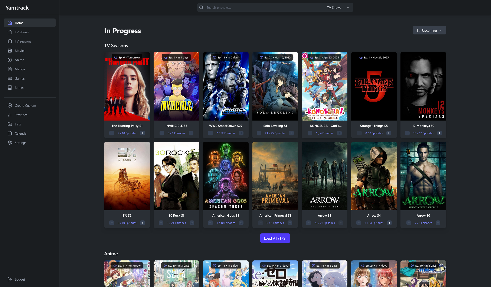

Screenshot: upstream's own homepage screenshot (FuzzyGrim/Yamtrack README), showing the media library with posters, ratings, and progress.

# Deploy and Host

Yamtrack is a self-hosted media tracker for movies, TV shows, anime, manga, video games, books, comics, and board games — your own private Trakt-style library with ratings, progress, a calendar of upcoming releases, and imports from Trakt, Simkl, AniList, and IMDb. One click deploys the official image (ghcr.io/fuzzygrim/yamtrack v0.26.3, AGPL-3.0) with a Redis 8 companion: the admin account is seeded on first boot, search works out of the box with upstream's shared metadata keys, and your library survives redeploys. The deploy form has two generated fields — a Django secret key and an admin password — and one auto-wired Redis host, nothing else to fill in. On first boot the admin account (`admin` + your generated password) is created automatically and open registration is closed; log in, search for a movie or show, and add it to your library.

## About Hosting

Yamtrack runs as one Python + Django service from the official image, pinned by digest, plus a Redis 8 companion service. The SQLite database lives on a Railway volume (`/yamtrack/db`) and the Redis append-only file on its own volume (`/data`); both survive redeploys. Railway's injected `PORT` is remapped onto nginx by the wrapper entrypoint on every boot (0.26.3 predates upstream's `YAMTRACK_INTERNAL_PORT` support), CSRF trusted origins are derived from the live public domain, and the healthcheck is upstream's own `/health/` (unauthenticated, 200). The marketplace incumbents ship the moving `:latest` tag, a three-service Postgres stack, and open registration with no seeded admin; this template fixes the usual failure modes (pinned digest, PORT remap, volume persistence for the SQLite database, generated secret + auto-seeded admin, registration closed by default).

## Why Deploy

- **Zero-fuss start:** no setup wizard to click through, no email step — the admin account is seeded on first boot and registration is closed so the instance is not world-open.
- **Real media tracking:** movies, TV, anime, manga, games, books, comics, and board games in one library, with ratings, progress, lists, a release calendar, and imports from Trakt, Simkl, AniList, and IMDb.
- **Search works out of the box:** TMDB, MyAnimeList, IGDB, Hardcover, and ComicVine ship shared default API keys upstream — bring your own keys only if you hit their rate limits.
- **Private by default:** your watch history and library stay in your own SQLite database on your own volume; no third-party tracker sees it.

## Common Use Cases

- Replace Trakt/Letterboxd/Goodreads with a single self-hosted library you own outright.
- Track what you watch, read, and play across media types, with progress and a calendar of upcoming releases.
- Import an existing Trakt, Simkl, AniList, or IMDb history and keep tracking from there.
- Run a private household tracker — one admin account, extra users managed from Django's `/admin/`.

## Dependencies for

### Deployment Dependencies

- **Runtime:** Yamtrack 0.26.3 (Python 3.12 + Django, nginx + gunicorn + celery) + Redis 8 companion; light — single gunicorn worker, SQLite. Fits the Hobby plan.
- **Port:** 8080 by default, mapped from Railway's injected `PORT` onto nginx on every boot.
- **Persistence:** one Railway volume at `/yamtrack/db` (SQLite database) and one volume at `/data` on the redis service (append-only file).
- **Healthcheck:** `/health/` (upstream's own probe, unauthenticated, 200).
- **Plan tier:** Hobby plan; two services (yamtrack + redis).

**Environment variables (condensed reference):** `SECRET` (`${{secret(50)}}` — Django secret key, generated; upstream's default is publicly known, never use it), `YAMTRACK_ADMIN_PASSWORD` (`${{secret(16)}}` — admin password, username `admin`), `REDIS_HOST` (`${{redis.RAILWAY_PRIVATE_DOMAIN}}` — auto-wired), `REGISTRATION` (`False`, baked — open signup closed), `ADMIN_ENABLED` (`True`, baked — Django `/admin/` enabled), `TZ` (`UTC`, baked), `URLS` (derived at boot from `RAILWAY_PUBLIC_DOMAIN` — CSRF trusted origins + allowed hosts), `YAMTRACK_INTERNAL_PORT` (set from `PORT` by the wrapper entrypoint; never `8001`), `YAMTRACK_ADMIN_USERNAME` (`admin`), `TMDB_API` / `MAL_API` / `IGDB_ID` / `IGDB_SECRET` / `HARDCOVER_API` / `COMICVINE_API` (optional — metadata-source keys; shared defaults ship upstream), `TMDB_LANG` / `TMDB_NSFW` / `MAL_NSFW` / `MU_NSFW` / `ANILIST_NSFW` / `IGDB_NSFW` (optional — search language and adult-content toggles), `PUID` / `PGID` (`1000`, upstream defaults), `WEB_CONCURRENCY` (`1`, upstream default), `TRACK_TIME` (`True`, upstream default), `DEBUG` (`False`, upstream default), `REDIS_PREFIX` (optional), `CELERY_REDIS_URL` (defaults to `REDIS_URL`), `HEALTHCHECK_CELERY_PING_TIMEOUT` (`1`, upstream default), `DB_HOST` (optional — set to use PostgreSQL instead of SQLite, with `DB_NAME`, `DB_USER`, `DB_PASSWORD`), `PORT` (injected by Railway and mapped automatically). See the [upstream environment variables documentation](https://fuzzygrim.github.io/Yamtrack/dev/env-variables/) for the full list, including social-auth / OIDC settings.
